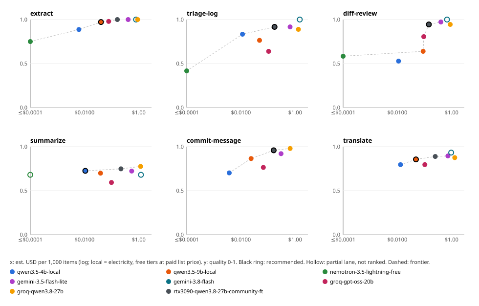

# cheapest-lane-bench

How cheap can a model be before quality drops? This benchmark answers that one bounded LLM
chore at a time. Each chore runs on every model lane this machine can reach, from a 4B local
model to cloud Flash models. Every output is scored against a hand-built golden set, and the
report names the cheapest lane that stays within 0.05 of the best quality for that chore.

The chores come from [llm-offload](https://github.com/oguzhanozfe/llm-offload). This repo does
not reimplement them. It imports llm-offload's task registry (system prompts, templates, JSON
schemas, output budgets), its result parser and its quote verifier from a pinned commit.
Ollama lanes run through llm-offload's own `backends.generate`.

## Why it matters

Routing bounded chores (summaries, log triage, commit messages) to the cheapest adequate model
is where most LLM spend can be saved. "Adequate" needs a number per chore, not a feeling. A 4B
model can be fine at one chore and useless at the next, and an aggregate leaderboard hides that.

## What is measured

| Chore (llm-offload task) | Golden items | Scoring |
| --- | --- | --- |
| `extract` | 12 | JSON validity, then field-level F1 against reference records (exact match for ids, numbers and dates; word overlap for free-text fields) |
| `triage-log` | 12 | JSON validity, F1 of the reported failures against the real failing tests, multiplied by the share of `quote`s found verbatim in the log |
| `diff-review` | 12 | JSON validity, F1 of findings against planted issues (3 diffs are clean, one is a removed-line trap), multiplied by the verbatim-quote rate |
| `summarize` | 12 | 50% deterministic (key-fact coverage, bullet limit), 50% rubric LLM judge |
| `commit-message` | 12 | 50% deterministic (Conventional Commits header, correct type, required keywords), 50% rubric judge |
| `translate` (TR↔EN) | 12 | 50% deterministic (code, links and numbers preserved byte-for-byte; chrF against a reference translation), 50% rubric judge |

The golden sets in [`golden/`](golden/) are synthetic, hand-built and reviewed. They use
fictional people and companies, example.com, and fake tokens. Each item carries its reference
answer.

The judge part is **weaker evidence** than the deterministic part. The primary judge
(`gemma-4-31b-it`) grades every free-text output 1-5 against the reference. A second judge
(`gemini-3-flash-preview`) grades a fixed sample so agreement can be reported. Neither judge is
a benchmarked lane, but both come from Google, so shared-vendor bias is not ruled out.

**Cost** is estimated per item from recorded token counts and list prices, which were read
from the vendors' pricing pages on 2026-11-17 and are listed in
[`bench/lanes.py`](bench/lanes.py). The Gemini runs used the free tier, so their dollar figure
is what the same traffic would cost on the paid tier. Local lanes are charged electricity
only, at an assumed 40 W and $0.30/kWh. The OpenCode free lane is $0.

## Results

Run on 2026-11-17 on an Apple-silicon Mac. The Mac's Ollama and the Gemini free-tier key were
shared with about 15 other jobs that day, so latency is pessimistic and some lanes could not
finish. Everything below is generated by `python -m bench.report` from the committed raw
outputs in [`results/runs/`](results/runs/) and judge grades in [`results/judge/`](results/judge/).
The chart is [`results/frontier.svg`](results/frontier.svg), with an HTML version in
`results/frontier.html`.



<!-- results:start -->
Quality is the mean per-item score in [0, 1]; a lane holds quality when it is within 0.05 of the best lane on that task. Cost is per 1,000 items. Lanes marked partial ran out of quota before every item was attempted; they are shown but not ranked.

### Recommendation

| Task | Cheapest lane that holds quality | Quality | Best lane | Best quality | Cost / 1k |
| --- | --- | --- | --- | --- | --- |
| extract | **qwen3.5-9b-local** | 0.97 | gemini-3.5-flash-lite | 1.00 | $0.0406 |
| triage-log | **gemini-3.5-flash-lite** | 0.92 | gemini-3.5-flash-lite | 0.92 | $0.6527 |
| diff-review | **gemini-3.5-flash-lite** | 0.97 | gemini-3.5-flash-lite | 0.97 | $0.4051 |
| summarize | **qwen3.5-9b-local** | 0.81 | gemini-3.5-flash-lite | 0.84 | $0.0391 |
| commit-message | **gemini-3.5-flash-lite** | 0.99 | gemini-3.5-flash-lite | 0.99 | $0.3030 |
| translate | **gemini-3.5-flash-lite** | 0.93 | gemini-3.5-flash-lite | 0.93 | $0.7346 |

### extract

| Lane | Attempted / OK | Quality (95% CI) | Deterministic | Judge 1-5 | p50 s | Tokens in/out | Cost / 1k | Frontier |
| --- | --- | --- | --- | --- | --- | --- | --- | --- |
| gemini-3.5-flash-lite | 12/12 (12 ok) | 1.00 (1.00-1.00) | 1.00 |  | 1.53 | 340/122 | $0.4073 | yes |
| qwen3.5-9b-local | 12/12 (12 ok) | 0.97 (0.93-1.00) | 0.97 |  | 11.33 | 307/146 | $0.0406 | yes |
| nemotron-3.5-lightning-free | 12/12 (12 ok) | 0.75 (0.50-1.00) | 0.75 |  | 6.6 | 8522/751 | $0 | yes |
| gemini-3.8-flash | 3/12 (2 ok) partial | 0.67 (0.00-1.00) | 0.67 |  | 212.06 | 358/100 | $0.6454 |  |

### triage-log

| Lane | Attempted / OK | Quality (95% CI) | Deterministic | Judge 1-5 | p50 s | Tokens in/out | Cost / 1k | Frontier |
| --- | --- | --- | --- | --- | --- | --- | --- | --- |
| gemini-3.5-flash-lite | 12/12 (12 ok) | 0.92 (0.75-1.00) | 0.92 |  | 1.54 | 542/196 | $0.6527 | yes |
| qwen3.5-9b-local | 12/12 (12 ok) | 0.76 (0.54-0.96) | 0.76 |  | 13.38 | 412/231 | $0.0486 | yes |
| nemotron-3.5-lightning-free | 12/12 (12 ok) | 0.42 (0.17-0.67) | 0.42 |  | 5.53 | 6965/955 | $0 | yes |

### diff-review

| Lane | Attempted / OK | Quality (95% CI) | Deterministic | Judge 1-5 | p50 s | Tokens in/out | Cost / 1k | Frontier |
| --- | --- | --- | --- | --- | --- | --- | --- | --- |
| gemini-3.5-flash-lite | 12/12 (12 ok) | 0.97 (0.92-1.00) | 0.97 |  | 0.93 | 621/88 | $0.4051 | yes |
| qwen3.5-9b-local | 12/12 (12 ok) | 0.64 (0.39-0.89) | 0.64 |  | 25.76 | 465/82 | $0.0895 | yes |
| nemotron-3.5-lightning-free | 12/12 (12 ok) | 0.58 (0.33-0.81) | 0.58 |  | 20.36 | 8796/3351 | $0 | yes |

### summarize

| Lane | Attempted / OK | Quality (95% CI) | Deterministic | Judge 1-5 | p50 s | Tokens in/out | Cost / 1k | Frontier |
| --- | --- | --- | --- | --- | --- | --- | --- | --- |
| gemini-3.5-flash-lite | 12/12 (12 ok) | 0.84 (0.76-0.92) | 0.84 | (pending; quality = deterministic only) | 1.88 | 498/160 | $0.5492 | yes |
| qwen3.5-9b-local | 12/12 (12 ok) | 0.81 (0.73-0.89) | 0.81 | (pending; quality = deterministic only) | 11.54 | 516/184 | $0.0391 | yes |
| nemotron-3.5-lightning-free | 3/12 (2 ok) partial | 0.45 (0.00-0.84) | 0.45 | (pending; quality = deterministic only) | 8.47 | 1668/1316 | $0 |  |

### commit-message

| Lane | Attempted / OK | Quality (95% CI) | Deterministic | Judge 1-5 | p50 s | Tokens in/out | Cost / 1k | Frontier |
| --- | --- | --- | --- | --- | --- | --- | --- | --- |
| gemini-3.5-flash-lite | 12/12 (12 ok) | 0.99 (0.96-1.00) | 0.99 | (pending; quality = deterministic only) | 1.19 | 527/58 | $0.3030 | yes |
| qwen3.5-9b-local | 12/12 (12 ok) | 0.92 (0.81-1.00) | 0.92 | (pending; quality = deterministic only) | 6.99 | 507/62 | $0.0237 | yes |

### translate

| Lane | Attempted / OK | Quality (95% CI) | Deterministic | Judge 1-5 | p50 s | Tokens in/out | Cost / 1k | Frontier |
| --- | --- | --- | --- | --- | --- | --- | --- | --- |
| gemini-3.5-flash-lite | 12/12 (12 ok) | 0.93 (0.92-0.95) | 0.93 | (pending; quality = deterministic only) | 3.85 | 351/252 | $0.7346 | yes |
| qwen3.5-9b-local | 8/12 (8 ok) partial | 0.90 (0.86-0.93) | 0.90 | (pending; quality = deterministic only) | 11.56 | 384/235 | $0.0408 |  |

### Judge agreement

No outputs were graded by both judges.

### Lanes not measured

- **deepseek-flash**: API key present but the account has no balance (HTTP 402); not topped up for this run.
- **codex-luna (gpt-5.6-luna)**: Codex CLI present but the ChatGPT account was over its usage pressure line.
- **rtx-3090 qwen3.8:27b**: Remote GPU box was unreachable on the run date.
<!-- results:end -->

## How to run

Python 3.10+, standard library only.

```bash
sh scripts/fetch-llm-offload.sh               # pinned, read-only clone into .deps/
python -m unittest discover -s tests          # offline: scorers, golden-set checks, reproducibility
python -m bench.report --check                # rescore the recorded outputs; fails if results/ or README drift
```

To measure your own lanes, use Ollama at `http://127.0.0.1:11434` (`OLLAMA_URL` overrides it)
plus any of `GEMINI_API_KEY`, `DEEPSEEK_API_KEY` or the `opencode` CLI:

```bash
python -m bench.run --lanes qwen3.5-4b-local,gemini-3.5-flash-lite --tasks extract,summarize
python -m bench.judge --judges primary        # rubric grades for summarize/commit-message/translate
python -m bench.report                        # tables, frontier chart, README block
```

Runs are resumable: finished items are skipped, so an interrupted run costs nothing to restart.
Lanes are defined in `bench/lanes.py` and judges in `bench/judge.py`.

CI runs only the offline parts. It runs the unit tests and recomputes every score and table
from the recorded outputs. No model or key is needed.

## Known limits

- **Small samples.** There are 12 items per chore. The 95% bootstrap intervals in the tables
  are wide, so a 0.05 tolerance band is narrower than the noise for most cells. Read the
  recommendation as "no evidence of a drop on this set", not as a guarantee.
- **Partial lanes.** A lane marked *partial* ran out of shared free-tier quota before every item
  was attempted. It is shown on the attempted items but never recommended.
- **Synthetic golden sets.** The data is written to resemble real chores, but it is not drawn
  from production traffic.
- **Unequal JSON enforcement.** Ollama enforces the JSON schema with a grammar. Cloud lanes get
  the same "respond with this schema" instruction llm-offload's Codex lane uses, so JSON
  validity is not a like-for-like comparison of the base models.
- **Context window.** Local lanes ran with an 8k context instead of llm-offload's 32k default,
  to avoid reloading the shared Ollama model. All golden inputs fit in under 2k tokens, so the
  model sees the same prompt either way.
- **OpenCode overhead.** The OpenCode free lane runs through an agent harness that adds about
  20k prompt tokens per call. It is free, rate-limited, and its provider may retain prompts.
- **Not reviewed for real-time rates.** Latency includes queueing behind other jobs on a shared
  machine and free-tier backoff. Use it for relative ordering only.

## License

MIT
